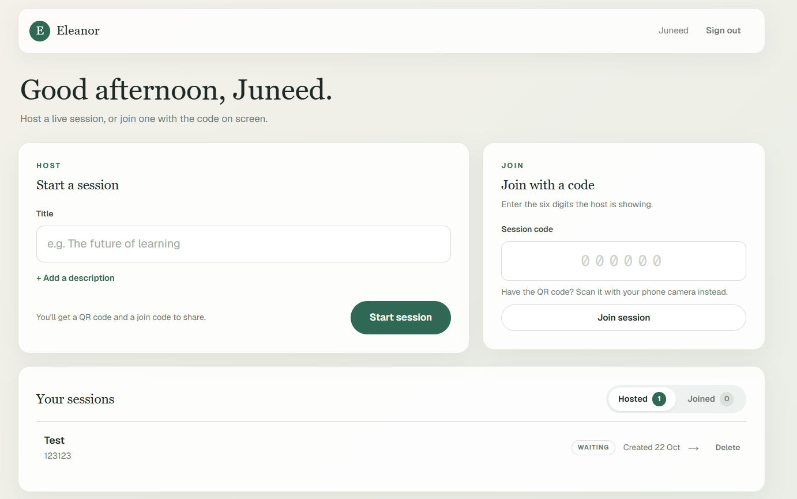
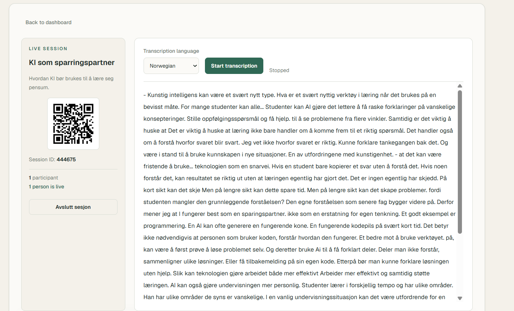
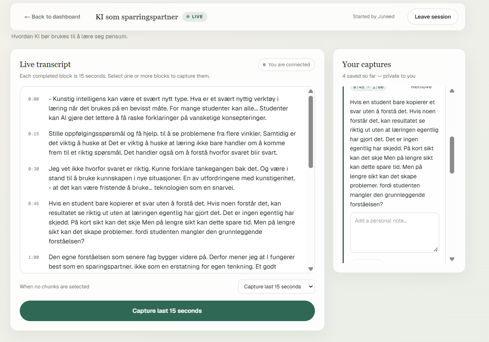
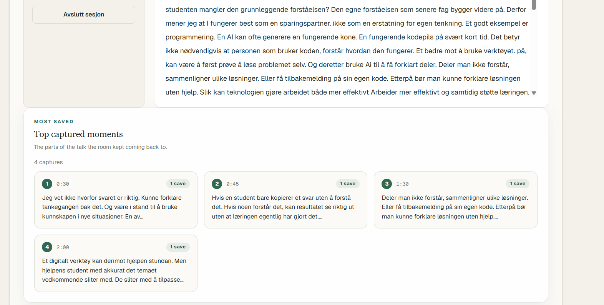
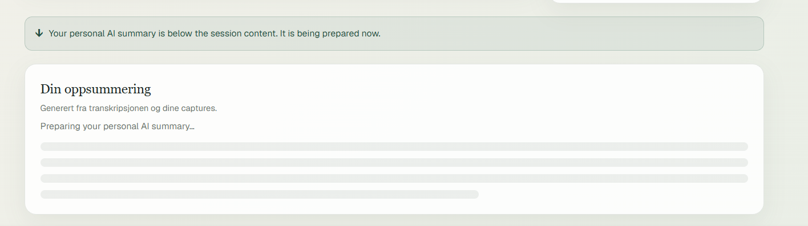

# Eleanor

Public showcase for **Eleanor**, an ongoing team project developed in collaboration with Human Learning Lab.

Eleanor is a learning tool built around live transcription, captured learning moments and AI-generated personal summaries. The project is still under active development, and the full source repository is private.

## My role

I work as both **project lead and developer** in a multidisciplinary team.

My contributions have included:

- session and participant flows
- organizer and participant pages
- transcription functionality, including language handling
- Firebase-backed application functionality
- integration and improvement of features across the shared codebase
- coordination of development work and technical direction within the team

## Technology

- Next.js
- React
- TypeScript
- Firebase Authentication
- Cloud Firestore
- Firebase Storage
- Speech recognition / transcription
- AI-generated summaries

## Screenshots

### Dashboard

Users can create new sessions, join existing sessions and access previous sessions from the dashboard.

### Organizer session

The organizer can manage a live session, share access through a QR code or session ID and follow the transcription while participants are connected.

### Participant view

Participants can follow the live transcript and save selected parts of the session as personal captures.

### Top captured moments

The organizer can see which moments were captured most often by participants without exposing individual participants' private captures.

### Personal AI summary

After a session ends, Eleanor prepares a personal AI-generated summary based on the session transcript and the participant's saved captures.

> **Work in progress:** The transcription and AI-summary pipeline are still being actively developed and refined. The current transcription can be inaccurate and may occasionally introduce words or phrases that were not actually spoken. Improving transcription reliability and reducing these errors is one of the areas we are currently working on. The AI-generated summary functionality is also still being tested and improved.

## Team development

Eleanor is developed collaboratively using Git and GitHub. My work in the private repository includes multiple merged pull requests and contributions to shared features.

The project has given me practical experience working in a shared codebase, coordinating changes with other developers, resolving integration issues and communicating technical decisions in a multidisciplinary team.

## Source code

The complete source code is currently kept in a private repository because Eleanor is still an active team project.

This public repository is therefore intended as a portfolio showcase rather than a copy of the production code.
